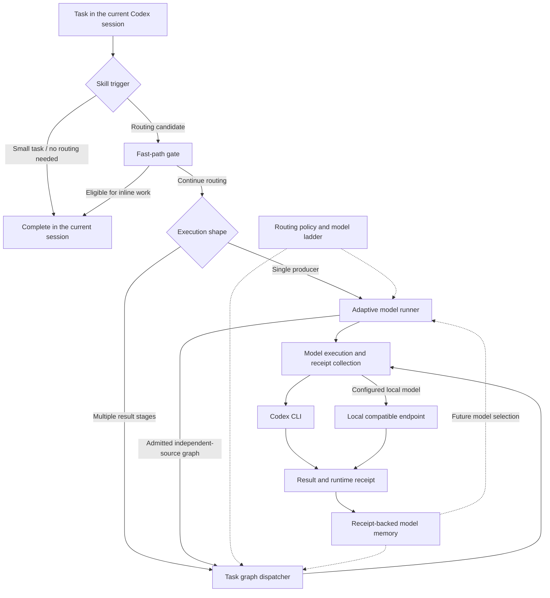

# Codex RouteKit

**Adaptive model routing for Codex, backed by execution evidence.**

[Quick start](#install) · [Architecture](#architecture) · [Configuration](#configuration) · [Benchmarks](#baseline--the-problem-not-the-result) · [Star this project](https://github.com/Elyon0517/codex-routekit)

A model-routing engine for Codex. Scores every task, skips routing entirely when the task is
too small to pay for it, serves repeat work from cache, and picks the cheapest model rung
proven to work for that task shape.

Formerly **Aureon**. Extracted from the routing core of qin-codex-skills. Uses the Python standard library only.

If this helps you understand or improve your Codex routing, please [give Codex RouteKit a star](https://github.com/Elyon0517/codex-routekit) ⭐ — it helps other builders discover the project.

The default branch is `main`. Start with the installation steps below, then evaluate a task
with `fast_path.py` before choosing to route it. Small tasks should stay in the current session.

---

## Features

| Stage | Module | What it does |
|---|---|---|
| **Gate** | `fast_path.py` | Regex-only eligibility check. Small, low-risk, single-file tasks skip the router, the contract load, and the receipt entirely. Costs 0 tokens and ~20 ms. |
| **Cache** | `result_cache.py` | Returns a stored result when prompt + input file *contents* + model pair all match. Editing any input changes the key, so stale entries cannot be served. |
| **Rungs** | `local_producer.py` | Adds a free local-model rung: `local ($0) → priority producer → quality ladder`. Off unless configured. |
| **Router** | `obsidian_adaptive_model_runner.py` | Scores 0–100, resolves the entry pair, runs one producer. Multi-stage requests go through `task_route_dispatcher.py`. |
| **Learning** | `obsidian_model_memory.py` | Receipt-backed only. 2 PASS → down a rung, quality FAIL → up a rung, stable pair freezes. Operational failures are neutral. |
| **Trigger** | `SKILL.md` | Its `description` is the first filter: small tasks never load the skill, so they cost nothing. 17 references load only when their situation occurs. |
| **Benchmark** | `benchmark_suite_runner.py` | Direct vs Auto A/B harness. `strategy_performance.py` is the only authority for a savings claim. |

---

## Architecture

Codex RouteKit separates task admission, model selection, execution evidence, and learning.
The skill decides when to load the engine; the fast-path gate checks whether a task can stay
in the current session. Only tasks that proceed to routing need a new execution session.



| Layer | Main modules | Responsibility |
|---|---|---|
| Admission | `SKILL.md`, `fast_path.py`, `task_signals.py` | Load routing instructions on demand and identify small tasks that can run inline. |
| Selection | `resolve_entry_model.py`, `routing_policy.py`, `model_registry.py` | Resolve the entry model and effort, available rungs, and routing constraints. |
| Orchestration | `obsidian_adaptive_model_runner.py`, `task_route_dispatcher.py` | Run a producer or coordinate graph nodes and their dependencies. |
| Execution and evidence | `model_execution_receipt.py`, `local_producer.py` | Execute the selected model and record the evidence available from that backend. |
| Learning | `obsidian_model_memory.py`, `session_effort.py` | Use verified outcomes and session context to inform subsequent routing decisions. |
| Reuse | `result_cache.py` | Provide an explicit cache CLI keyed by prompt, input contents, and model/effort pair. |
| Measurement | `benchmark_suite_runner.py`, `strategy_performance.py` | Compare Direct and Auto runs and report measured performance. |

**Cache integration:** the result cache is a separate utility, not an automatic step in every
runner or dispatcher call. A caller can look up a matching result before execution and store
a reusable result afterward using the [cache commands](#commands).

**Evidence boundary:** Codex receipts are reconstructed from CLI events, the threads database,
and rollout files. Local execution records only what its backend can actually observe.
Unverified model assignments must not be treated as receipt-backed learning evidence.

**State boundary:** the committed `assets/` directory supplies the frozen model ladder and
fixtures. Runtime history and caches default to `~/.codex/model-routing-memory/`; graph output
and receipt paths are determined by the execution configuration. Optional Obsidian projection
is not required for routing.

---

## Baseline — the problem, not the result

Upstream's routing on a frozen 12-run cohort, **before the gate existed**:

| Tier | Direct tokens | Routed tokens | Savings |
|---|---:|---:|---:|
| simple | 32,654 | 93,448 | −186.2% |
| medium | 49,451 | 91,398 | −84.8% |
| complex | 538,903 | 273,442 | +49.3% |

Routing overhead was ~36,800 tokens per run against a simple-tier task worth ~16,300 total.
These tiers are what the gate is aimed at. They are not this engine's results.

## Measured here

| | Before | Here | How |
|---|---:|---:|---|
| Contract loaded when routing | ~10,985 tok | **~1,189 tok** | `wc -c` on both files, ÷4 |
| Contract loaded for a small task | ~10,985 tok | **0** | skill never triggers |
| Gate modules loaded | 111 | **20** | `len(sys.modules)` before/after import |
| Gate wall time | 60 ms | **20 ms** | `time` over the CLI |
| Tests | — | **641** | full suite |

Direct measurements of this repo, taken on one machine.

## Measured on a real Codex run

Two trivial tasks put through the full router, `gpt-5.6-luna` entry, receipts traced back to
rows in Codex's own `state_5.sqlite`:

| Task | Total | Uncached input | Output | Output share |
|---|---:|---:|---:|---:|
| List 5 function names (read-only) | 64,980 | 15,425 | 403 | 0.62% |
| Fix one typo, `teh` → `the` | 96,584 | 16,190 | 1,034 | 1.07% |

These two routed runs consumed 65–97k logical tokens in total. They demonstrate substantial
fixed session overhead, but do not establish a universal cost for every `codex exec` run. That fixed cost is the thing worth avoiding — beside it,
model and effort selection alone cannot be assumed to offset it.

Same task text, both paths:

| | Gate | Route |
|---|---|---|
| Decision | 0 tokens, 20 ms | — |
| Execution | done inline by the agent already running | 96,584 tokens, 36.5 s |

The gate does not make the work free — the task still has to be done. It avoids **spawning a
second session** to do it.

`total_tokens` is a logical count, not a bill. Most of the input is cached (79,360 of 95,550
on the edit), and cached input is normally priced far below uncached.

## Still not measured

The three-tier baseline has not been re-run end to end with the gate in place. That needs an
authored benchmark suite (`snapshot/`, `prompts/`, `expected/`) and both cohort homes, and the
Direct arm is pinned to `gpt-5.6-sol|ultra`.

---

## Requirements

- Python 3.11+ (standard library only, no pip install)
- **Codex CLI on `PATH`** for the routing half

Codex-only is structural: receipt evidence is reconstructed from the `codex --json` event
stream, Codex's `threads` database, and its rollout files. Other agent CLIs do not expose
equivalent evidence, and the learning loop only moves on verified receipts.

The gate, the score, and the cache have no Codex dependency, but they exist to feed the
router — without it they have nothing to gate or cache.

---

## Install

```bash
git clone --branch main https://github.com/Elyon0517/codex-routekit.git
cd codex-routekit
python3 -m unittest discover -s tests -p 'test_*.py' -b
```

Install as a Codex skill, so it loads only when a task is worth routing:

```bash
mkdir -p ~/.codex/skills/token-saver
ln -s "$PWD" ~/.codex/skills/token-saver/engine
cp SKILL.md ~/.codex/skills/token-saver/SKILL.md
```

Replace `<engine>` in the copied `SKILL.md` with your checkout path. Quote it in every command
if the path contains spaces.

There is deliberately **no always-resident bootstrap**. The skill's `description` is the filter:
a single-file edit, a rename, a question, or a typo fix never loads it, so those tasks pay
nothing at all — not a resident contract, not a tool call. Only work whose description matches
(three or more coordinated files, an architecture or migration decision, a multi-stage graph,
or an explicit routing request) loads the skill, and `fast_path.py` then confirms
deterministically before anything is spawned.

---

## Configuration

All optional. Defaults keep the extras off.

### Local model rung

```bash
export TOKEN_SAVER_LOCAL_BASE_URL=http://127.0.0.1:8000/v1
export TOKEN_SAVER_LOCAL_MODEL=your-local-model
python3 scripts/local_producer.py --status
```

| Variable | Default | Effect |
|---|---|---|
| `TOKEN_SAVER_LOCAL_BASE_URL` | — | Enables the rung (required) |
| `TOKEN_SAVER_LOCAL_MODEL` | — | Model name (required) |
| `TOKEN_SAVER_LOCAL_API_KEY` | `none` | Bearer token |
| `TOKEN_SAVER_LOCAL_TIMEOUT` | `60` | Seconds |
| `TOKEN_SAVER_LOCAL_ENABLE_THINKING` | off | Allow a reasoning preamble |

Any OpenAI-compatible server works: LM Studio, Ollama, vLLM, MLX. Thinking is off by default
because reasoning models spend hundreds of tokens on a hidden preamble before answering.

The rung offers only effort `low`. A node requesting another effort is refused, not silently
downgraded. Unreachable backend, timeout, or empty output is an operational failure: it falls
through to the next rung and is not recorded as a quality failure.

### Cache

| Variable | Default | Effect |
|---|---|---|
| `TOKEN_SAVER_RESULT_CACHE` | `~/.codex/model-routing-memory/result-cache.sqlite` | Location |
| `TOKEN_SAVER_RESULT_CACHE_DISABLED` | off | Bypass reads and writes |

Entries expire after 30 days on lookup. Empty results are never stored.

### Storage and routing

| Variable | Default | Effect |
|---|---|---|
| `TOKEN_SAVER_FAST_PATH_LEDGER` | `~/.codex/model-routing-memory/fast-path-events.jsonl` | Gate ledger |
| `CODEX_MODEL_ROUTING_MEMORY` | `~/.codex/model-routing-memory/events.jsonl` | Routing ledger |
| `CODEX_OBSIDIAN_VAULT` | — | Optional Obsidian projection; absence is a no-op |
| `TOKEN_SAVER_REQUIRE_INSTALLED_SKILLS` | off | Require plan `skill` ids to exist on disk |
| `TOKEN_SAVER_ENGINE_ROOT` | — | Explicit engine root for the benchmark bridge |

### Model ladder

Built from the local Codex model cache. Ordinary routing never rescans it.

The ladder committed under `assets/` is frozen: it is the default and what the test suite
runs against. Generate your machine's ladder **outside the repo** and point the engine at it:

```bash
mkdir -p ~/.codex/token-saver
python3 scripts/sync_model_capabilities.py --update \
  --registry ~/.codex/token-saver/model-capability-ladder.json \
  --output   ~/.codex/token-saver/model-capabilities.md

export TOKEN_SAVER_MODEL_LADDER=~/.codex/token-saver/model-capability-ladder.json
```

| Variable | Default | Effect |
|---|---|---|
| `TOKEN_SAVER_MODEL_LADDER` | `assets/model-capability-ladder.json` | Ladder the engine loads |

Rewriting the committed asset instead would make the suite pass or fail on which models the
local Codex catalog happens to expose — a machine without the priority producer builds a valid
but different ladder, and 79 tests that name it would fail.

Never fetches over the network. If the cache is unavailable, the last valid ladder is kept.

---

## Commands

**Gate and score**

```bash
python3 scripts/fast_path.py evaluate "<task>"                 # exit 0; .eligible decides
python3 scripts/fast_path.py record "<task>" --outcome pass    # or: --outcome corrected
python3 scripts/fast_path.py suppressed                        # suppressed task shapes
python3 scripts/task_complexity_score.py "<task>"              # score only
```

A task is admitted when all hold: score ≤ 24, low risk, low ambiguity, at most one file, not
read-only, and no disqualifying signal (multi-file, structural, security, irreversible,
multi-stage, concurrency).

`--outcome corrected` suppresses that task shape. The fingerprint is a bounded category
(type + operation + band), not a per-task identity, so similar small tasks are suppressed too.

**Cache**

```bash
python3 scripts/result_cache.py lookup "<prompt>" --file a.py --pair "model|effort"
python3 scripts/result_cache.py store  "<prompt>" --result "<text>" --file a.py --pair "model|effort" --total-tokens 700
python3 scripts/result_cache.py stats            # hit_rate, hits, misses, tokens_avoided
python3 scripts/result_cache.py purge [--max-age-days N]
```

`lookup` exits 0 on a hit, 1 on a miss.

**Route and execute**

```bash
python3 scripts/obsidian_adaptive_model_runner.py --emit-result ...
python3 scripts/task_route_dispatcher.py run-plan <plan.json>
python3 scripts/local_producer.py --status
```

**Benchmark**

```bash
python3 scripts/benchmark_suite_runner.py \
  --suite-root <dir> \
  --direct-codex-home <dir> --global-codex-home <dir> \
  --tier-repeats simple=4,medium=2,complex=2

python3 scripts/strategy_performance.py
```

Both arms must share prompt, inputs, cwd, sandbox, configuration, output contract, and
acceptance. Controller overhead, retries, and verification are reported separately from the
steady-state savings figure.

---

## Layout

```
SKILL.md                     the skill; its description decides when it loads (~1,189 tok)
contracts/
  references/                17 docs, loaded on demand
scripts/                     32 modules
  fast_path.py               gate
  result_cache.py            cache
  local_producer.py          local rung
  task_signals.py            dependency-free prompt signals
  routing_policy.py          rung admission and ladder movement
  model_registry.py          ladder built from the local model cache
  model_execution_receipt.py execution and receipt reconstruction
  obsidian_model_memory.py   receipt-backed learning
  task_route_dispatcher.py   multi-node graph execution
  benchmark_*.py             measurement harness
tests/                       641 tests
assets/                      model ladder, route fixtures, benchmark evidence
```

Private state — routing history, receipts, ledgers, caches — stays under
`~/.codex/model-routing-memory/` and is never committed.

---

## Whether this is worth installing

Be clear about what the engine does and does not save.

The 65k–97k is not overhead the engine removes. It is overhead the engine **introduces** by
spawning a second session. The gate's job is to stop it spending that on work that never
needed one. That brings a net loss back to zero; it does not by itself produce a gain.

A gain requires the task to be large enough that running it on a weaker rung saves more than
the spawn costs. Upstream's own cohort found that true only for the complex tier (+49.3%);
simple and medium were −186.2% and −84.8%.

| Your typical work | Recommendation |
|---|---|
| Mostly small edits, questions, single-file changes | **Do not install.** Doing the work in your existing session is already the cheapest path. |
| Regularly large, multi-file, architecture-level tasks, driven from a strong model | Worth installing — the spawn amortises. Take your own baseline first. |

Use the engine only when measured routing savings exceed the session overhead for your workload.

## Not included

- **Context offloading** — passing file paths to a sub-agent so file contents never enter the
  parent context. The largest remaining lever; `source_allowlist` on graph nodes is the hook.
- **Backend portability** — see Requirements.
- **The upstream lifecycle skills** — `management`, `optimization`, `code`, `prompt`,
  `workflow`, and the prose validators.

## Support the project

If Codex RouteKit is useful to you, **[give it a star on GitHub](https://github.com/Elyon0517/codex-routekit)** ⭐.
It helps more developers discover evidence-based model routing.

Have a reproducible routing issue or an idea for improvement?
[Open an issue](https://github.com/Elyon0517/codex-routekit/issues) with the task shape, expected
behavior, and sanitized evidence. Please remove prompts, paths, and credentials that should
remain private before sharing receipts or logs.

## Source, copyright and attribution

Original project: [Elyon0517/codex-routekit](https://github.com/Elyon0517/codex-routekit), maintained by
[Elyon0517](https://github.com/Elyon0517). Project code is available under the [MIT License](LICENSE), subject to file-specific and third-party notices. Redistributions must preserve the applicable copyright and permission notices.

For articles, demos and derivatives, please credit the original project and link here.
That link is a courtesy request, not an extra restriction on an existing open-source license.
See [copyright and third-party boundaries](COPYRIGHT.md) and [citation metadata](CITATION.cff).
